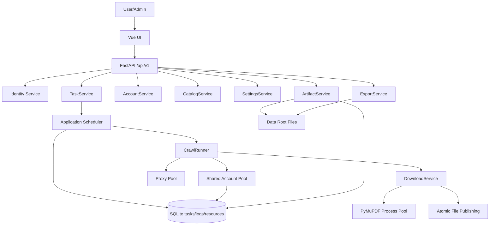

# FastAPI / Vue Domain Topology

This application runs the same FastAPI API, domain services, crawler core, SQLite store,
and Vue UI in both local GUI and server modes.



## Layer Rules

- Vue renders the task center, task detail, file library, account pool, and settings pages.
- Vue submits work, polls status, previews files, and downloads results through `/api/v1`.
- FastAPI owns authentication, request validation, CSRF, errors, and response shape.
- Application services own use-case orchestration.
- Domain core owns crawler, account rotation, proxy switching, download policy, and recovery.
- Infrastructure owns SQLite, file access, HTTP sessions, and conversion processes.
- RuntimeAdapter is the only place that knows whether the app is running as local GUI or server.

## Runtime Modes

- Local GUI: listens on `127.0.0.1` with an automatically selected port, opens the browser,
  and logs in via a one-time bootstrap token. Local-only APIs can open a folder picker or
  reveal downloaded files on the desktop.
- Server: listens on `0.0.0.0:{port}` or the host passed on the command line. External HTTPS,
  domains, firewalls, and reverse proxies are deployment-owned and not generated by this app.

## Task Flow

1. The user submits accounts and task filters.
2. TaskService persists a queued task with an immutable spec snapshot.
3. The scheduler runs up to two active tasks by default.
4. CrawlRunner scans catalog combinations, rotates accounts, switches proxies, and downloads.
5. Files are written to temporary paths and atomically published.
6. ArtifactService registers published files for preview/download.
7. ExportService creates ZIP files from registered artifact snapshots.

New task files are stored under:

```text
{data_root}/tasks/{task_id}/{subject}/{grade}/{term}/{province}/{scene}/{resource_name}_{resource_id}
```

All preview/download APIs accept registered artifact IDs instead of raw paths.

## Source Packaging

GitHub Actions publishes source archives only. Local installation scripts install Python
dependencies and build `stzy_app/frontend/dist` when frontend assets are missing.
Developers can rebuild the same frontend assets with
`scripts/run_fastapi_frontend.sh --rebuild-frontend` or the Windows PowerShell equivalent.
